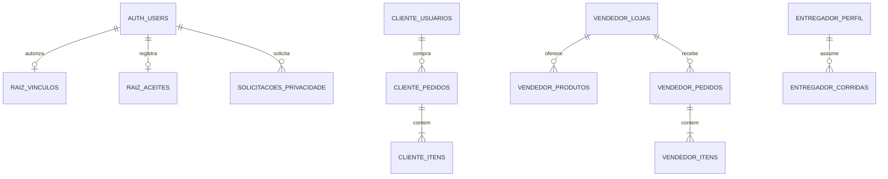

# Contrato web e banco versionado

Esta descrição corresponde às migrations deste repositório. O banco remoto precisa ser comparado pelo diagnóstico SQL antes de afirmar equivalência.

Pedidos de cliente, vendedor e corrida compartilham um ID gerado no checkout; essa correspondência é mantida pelas RPCs transacionais, não por FK entre as três tabelas. Cada lista tem view pública com `security_invoker=true`; tabelas usam RLS. Nenhum app escreve diretamente em pedidos, estoque, perfis de acesso ou saldo.

Navegação web: portal → login/cadastro/recuperação → área da persona. Cliente: catálogo, carrinho, pedidos, endereço e privacidade. Vendedor: loja, produtos, pedidos e privacidade. Entregador: disponibilidade, entregas, ofertas, histórico e privacidade. Admin: usuários, moderação, pedidos, entregas, exclusões e eventos. Documentos públicos: termos, privacidade e exclusão.

Cliente `Confirmado` → `Em preparação` → `Em transporte` → `Entregue`, com confirmação posterior em `recebimento_confirmado_em`. Cancelamento é terminal e devolve estoque. Avaliação pertence ao pedido de uma única loja e exige recebimento confirmado.

Pendências explicitamente adiadas: cobrança e reembolso reais, upload de imagens/Storage, rastreamento em tempo real, saques e implementação mobile. Nenhuma dessas funções é anunciada como integrada. Infraestrutura remota, SMTP, restauração, carga e revisão jurídica dependem de homologação operacional.
